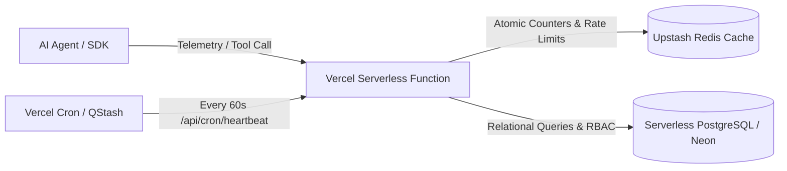

# Agent Shield — Production & Vercel Deployment Readiness Assessment

This document analyzes the deployment architecture of Agent Shield, explicitly detailing what **will work**, what **will not work**, and what requires modification when deploying to serverless platforms such as **Vercel** versus dedicated container environments.

---

## 1. Executive Deployment Readiness Matrix

| Subsystem | Local / Docker / VPS | Vercel (Current SQLite Design) | Postgres + Redis Target Architecture |
| :--- | :--- | :--- | :--- |
| **Next.js Web UI & Dashboards** | ✅ **Works** | ✅ **Works** | ✅ **Works** |
| **Central Access Layer & RBAC** | ✅ **Works** | ⚠️ **Read-Only / Ephemeral** | ✅ **Fully Scalable** |
| **Database Persistence (`node:sqlite`)** | ✅ **Works** | ❌ **FAILS (Ephemeral Filesystem)** | ✅ **Persistent via PostgreSQL** |
| **Background Daemon (`services/worker`)** | ✅ **Works** | ❌ **FAILS (No Long-Running Daemons)** | ✅ **Vercel Cron / QStash Worker** |
| **Forward Proxy Gateway (`/api/gateway/proxy`)** | ✅ **Works** | ⚠️ **Limited (Request Timeout Caps)** | ✅ **Dedicated Edge Sidecar** |
| **In-Memory Rate Limiter** | ✅ **Works** | ❌ **FAILS (Not Shared Across Lambdas)** | ✅ **Distributed via Upstash Redis** |
| **Telemetry Ingestion API** | ✅ **Works** | ⚠️ **Transient across Cold Starts** | ✅ **Globally Consistent** |
| **NEAR Testnet RPC Connectivity** | ✅ **Works** | ✅ **Works (Outbound Fetch)** | ✅ **Works** |

---

## 2. Technical Analysis: Why the Current Design Fails on Vercel

### 2.1. Embedded SQLite (`node:sqlite`) & The Serverless Ephemeral Filesystem
* **Current Implementation**: Agent Shield utilizes the Node.js native embedded SQLite module (`import { DatabaseSync } from 'node:sqlite'`) with a local file path (`data/agent-shield.db`).
* **The Vercel Serverless Constraint**:
  1. **Read-Only Root**: Serverless Lambda runtimes on Vercel have a read-only root filesystem. The only writable directory is `/tmp`.
  2. **Non-Persistent Storage**: The `/tmp` directory is ephemeral. Files written to `/tmp` are discarded whenever the function instance scales to zero, restarts, or handles cold starts.
  3. **Multi-Instance Isolation**: If two requests execute concurrently, Vercel routes them to separate function containers with completely independent `/tmp` directories. Mutations in Container A (e.g., registering an agent or logging an incident) will **never be visible** to Container B.
  4. **Database File Locks**: SQLite is not designed for concurrent writes across multiple independent serverless containers accessing shared network disks.
* **Verdict for Vercel**: **Will NOT persist data in production.** Invocations will repeatedly revert to the initial seed state upon cold starts.

---

### 2.2. Background Worker (`services/worker`)
* **Current Implementation**: The background worker runs an event-driven Node.js loop with a 30-second `setInterval` heartbeat monitor and scheduled morning incident digest generation.
* **The Vercel Serverless Constraint**:
  - Vercel functions freeze immediately after returning an HTTP response (`NextResponse.json(...)`).
  - There is no background process pool or standing daemon to execute timer loops while requests are idle.
* **Verdict for Vercel**: **Background heartbeats and morning digests will NOT execute autonomously** without incoming external requests.

---

### 2.3. In-Memory Token-Bucket Rate Limiter
* **Current Implementation**: `checkSubmissionRateLimit` and ingestion rate limiters store token buckets in local process memory (`Map<string, { count, windowStart }>`).
* **The Vercel Serverless Constraint**:
  - Memory is isolated per container. An attacker can bypass the 5-requests-per-10-minutes limit by hitting different parallel lambda invocations.
* **Verdict for Vercel**: **Rate limits are local to a single ephemeral instance** and provide zero protection against distributed abuse across parallel serverless invocations.

---

### 2.4. Forward Proxy Gateway (`/api/gateway/proxy`)
* **Current Implementation**: Intercepts HTTP/JSON-RPC requests, inspects payload arguments against policy rules, and proxies upstream to `https://rpc.testnet.near.org`.
* **The Vercel Serverless Constraint**:
  - Vercel functions impose hard execution timeout limits (10 seconds on Hobby tier, 60 seconds on Pro tier).
  - High-concurrency agent tool streaming or long-polling will hit connection timeouts and concurrency limits.

---

## 3. The Production Architecture Migration: PostgreSQL + Redis

To operate seamlessly on Vercel or any serverless cloud provider, Agent Shield requires two architectural modifications:



### 3.1. Database Migration: SQLite to Serverless PostgreSQL (Neon / Supabase)
1. **Schema Mapping**:
   The table schemas in `src/lib/db/database.ts` are 100% ANSI SQL compatible.
   - `accounts`, `workspaces`, `workspace_members`, `agents`, `agent_credentials`, `policies`, `audit_logs`, `threat_reports`, `near_anchors`.
   - `TEXT` &rarr; `VARCHAR` / `TEXT`
   - `INTEGER` (boolean flags) &rarr; `BOOLEAN`
   - `JSON` strings &rarr; Native PostgreSQL `JSONB` for indexing.
2. **Connection Pooling**:
   Use `@neondatabase/serverless` with WebSocket pooling or `pg` with PgBouncer to prevent exhausting database connection pools during serverless scale spikes.

### 3.2. Rate Limiting & Deduplication: In-Memory Maps to Upstash Redis
1. Replace in-memory token buckets with `@upstash/ratelimit`:
   ```typescript
   import { Ratelimit } from '@upstash/ratelimit';
   import { Redis } from '@upstash/redis';

   const ratelimit = new Ratelimit({
     redis: Redis.fromEnv(),
     limiter: Ratelimit.slidingWindow(5, '10 m')
   });
   ```
2. Ingestion idempotency checks (`eventId` deduplication) stored in Redis with an automatic 24-hour TTL.

### 3.3. Background Worker Migration: Standing Daemon to Vercel Cron
1. Configure `vercel.json` cron jobs:
   ```json
   {
     "crons": [
       {
         "path": "/api/cron/evaluate-heartbeats",
         "schedule": "* * * * *"
       },
       {
         "path": "/api/cron/morning-summary",
         "schedule": "0 8 * * *"
       }
     ]
   }
   ```
2. The cron endpoints authenticate via `CRON_SECRET` authorization header and execute the exact same logic as `services/worker`.

---

## 4. Recommended Production Deployment Environments Today

For the current codebase, the recommended production environments are:

### Option 1: Docker Container (Render, Railway, Fly.io, AWS ECS)
* Single persistent container runs Next.js server with persistent Docker volume mounted at `/app/data`.
* SQLite and in-memory rate limiters work with 100% fidelity.
* Background worker runs as a companion process (`supervisord` or multi-stage container).

### Option 2: Linux VPS / Bare Metal
* Direct deployment via Node.js 22/24 and systemd service units for `agent-shield` and `agent-shield-worker`.

